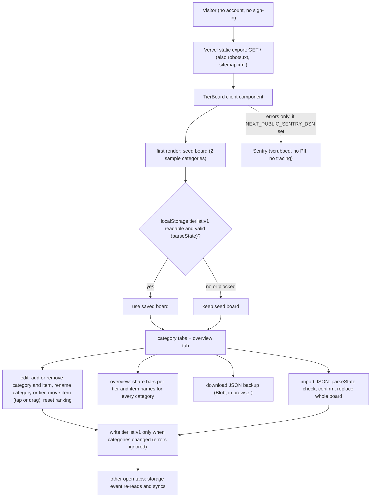

# 01 — Business process (As-Is / To-Be)

life-tierlist-web คือเว็บ static หน้าเดียวสำหรับจัดอันดับ S–D ได้หลายหมวดแล้วดูภาพรวมทุกหมวดในหน้าเดียว ใครเปิดเว็บก็ใช้ได้โดยไม่ต้องมีบัญชี ข้อมูลอยู่ใน `localStorage` ของเบราว์เซอร์นั้นเท่านั้น ไม่มี server และไม่เรียก API ใด

Last reviewed: 2026-11-27 · commit `2c5b850`

## As-Is (จากโค้ดวันนี้)

Sources: `app/page.tsx`, `app/tier-board.tsx` (`TierBoard`, `loadSaved`, `persist`, `boardReducer`, `BackupTools`, `Overview`), `lib/tierlist.ts` (`initialState`, `reducer`, `parseState`, `distribution`), `next.config.ts` (`output: 'export'`), `app/robots.ts`, `app/sitemap.ts`, `instrumentation-client.ts`, `lib/sentry.ts`, `README.md`, `PRODUCT.md`

ข้อเท็จจริงสำคัญจากโค้ด:

- ไม่มี route handler, server action หรือ `fetch` ไปบริการใด: ข้อมูลที่ผู้ใช้พิมพ์ไม่ออกจากเบราว์เซอร์ (ยกเว้นรายงาน error ไป Sentry ถ้าตั้ง DSN)
- การสลับหมวดอย่างเดียวไม่เขียน storage เพื่อไม่ให้แท็บเก่าเขียนทับบอร์ดใหม่กว่า
- ไฟล์นำเข้าที่รูปแบบผิดถูกปฏิเสธก่อนถามยืนยัน และการนำเข้าแทนที่ข้อมูลทั้งหมด
- deploy: push ขึ้น `main` แล้ว Vercel deploy เอง (`README.md`); ไม่มี deploy config ใน repo นอกจาก Vercel Git link [ต้องยืนยัน]

## To-Be

ไม่มี To-Be ที่เขียนไว้ `PRODUCT.md` §ต่อได้ภายหลัง มีแค่รายการไอเดียที่ยังไม่ได้ตัดสินใจ (รูปภาพในของแต่ละชิ้น, export เป็น PNG, ลากเรียงด้วยนิ้วบนมือถือ, sync ข้ามเครื่องที่ต้องมี backend และผ่าน security-and-privacy ก่อน) ไม่ใช่เป้าหมายที่กำหนดแล้ว

## Gap

| ID | As-Is → To-Be | Status | Owner | Evidence |
|---|---|---|---|---|
| G1 | ไม่มี To-Be ที่เขียนไว้ → owner เลือกว่าไอเดียใดใน `PRODUCT.md` §ต่อได้ภายหลัง เป็นเป้าหมาย (หรือคงไว้แบบนี้) | decide | owner | `PRODUCT.md` §ต่อได้ภายหลัง |

## Open questions

- ถ้าจะทำ sync ข้ามเครื่อง ต้องมี backend และผ่าน security-and-privacy review ก่อน (`PRODUCT.md`): owner ต้องการหรือไม่
